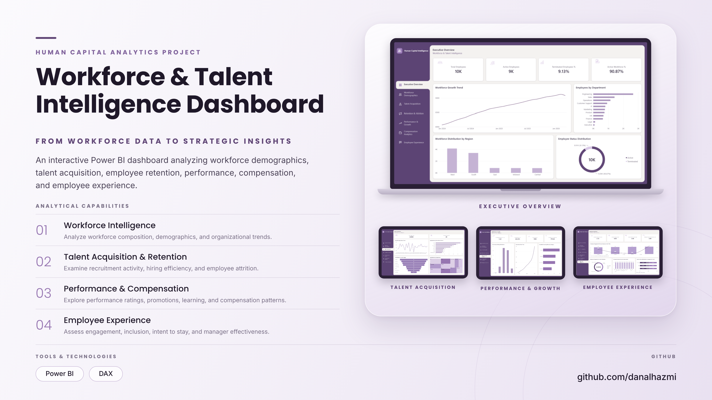
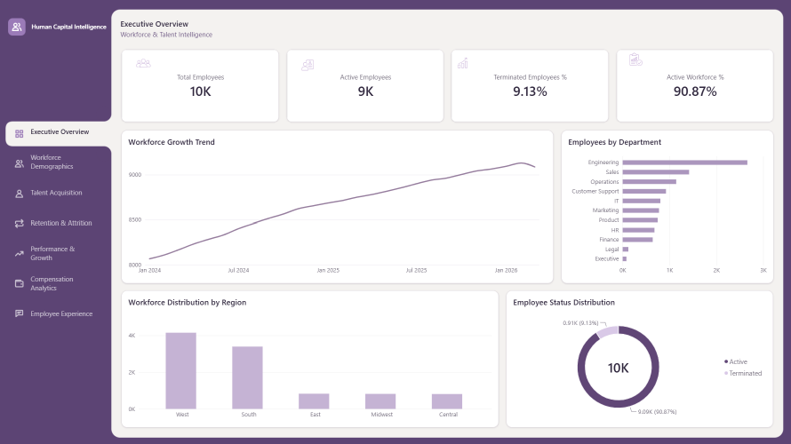
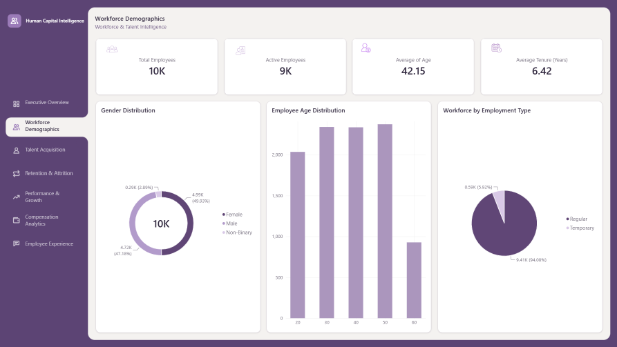
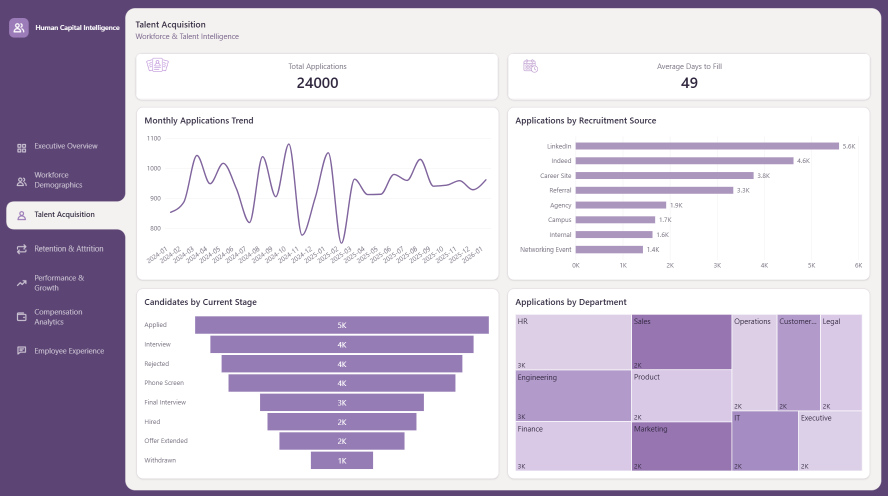
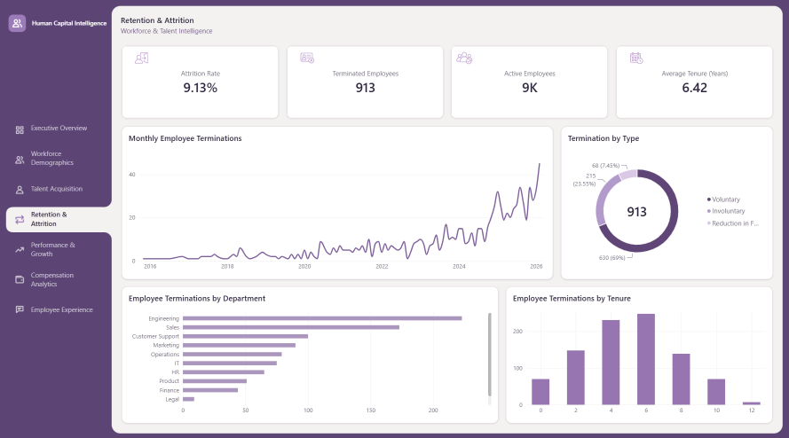
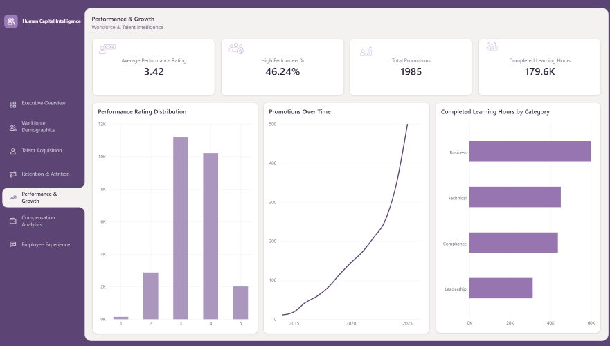
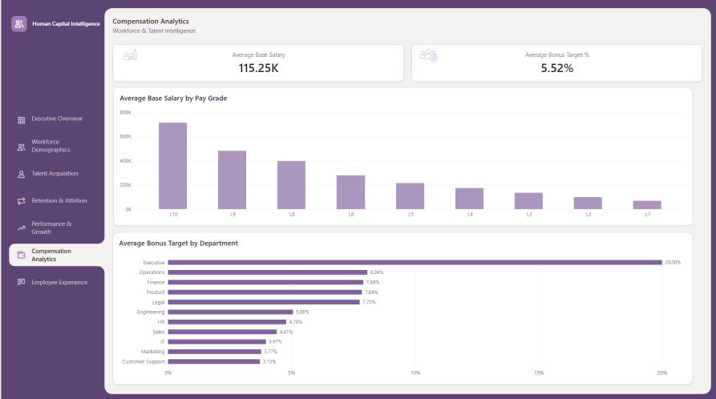
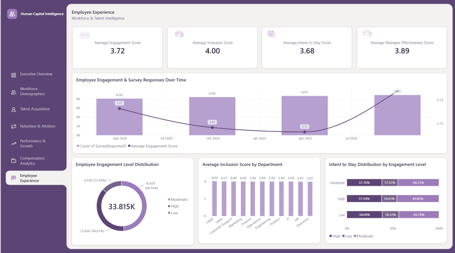
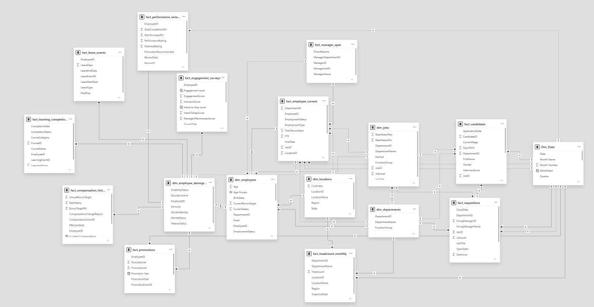

<p align="center">
  
</p>

<h1 align="center">WORKFORCE & TALENT INTELLIGENCE</h1>

<p align="center">
  <strong>Human Capital & Workforce Analytics</strong>
</p>

<p align="center">
  An interactive Power BI solution for analyzing workforce demographics, talent acquisition, employee retention, performance, compensation, and employee experience.
</p>

<p align="center">
  <a href="https://app.powerbi.com/view?r=eyJrIjoiM2VjZjc3NjgtZTk4OC00ZjYyLTllYjQtZTI5Zjg3NGJhMTc4IiwidCI6IjJkMzE5NGUzLTE2NTQtNDZiZC1iYWUyLWFkMzdiYTExYjBhZSIsImMiOjl9">
    <strong>VIEW INTERACTIVE DASHBOARD →</strong>
  </a>
</p>

<p align="center">
  <strong>10K</strong> Employees &nbsp;&nbsp;·&nbsp;&nbsp;
  <strong>90.87%</strong> Active Workforce &nbsp;&nbsp;·&nbsp;&nbsp;
  <strong>9.13%</strong> Attrition Rate &nbsp;&nbsp;·&nbsp;&nbsp;
  <strong>24K</strong> Applications
</p>

<br>

---

## 01 | THE CHALLENGE

Workforce decisions depend on more than employee headcount alone. Recruitment activity, retention, performance, compensation, and employee experience all contribute to understanding an organization's human capital.

The challenge was to bring these areas together into one reporting environment instead of analyzing workforce information across separate datasets. The dashboard was developed to provide a consolidated view of workforce composition, talent movement, employee development, and organizational trends.

The analysis focuses on three questions:

1. How is the workforce distributed across departments, regions, and employee groups?
2. What patterns can be identified in recruitment, employee retention, and performance?
3. How do compensation, professional development, and employee experience vary across the organization?

<br>

---

## 02 | ANALYTICAL SCOPE

The report is organized into seven analytical views, each focusing on a different dimension of human capital intelligence.

| Area | Analysis |
|---|---|
| **Executive Overview** | Workforce headcount, active workforce percentage, workforce growth, departmental distribution, and regional composition |
| **Workforce Demographics** | Gender distribution, employee age, employment type, and average tenure |
| **Talent Acquisition** | Application trends, recruitment sources, candidate stages, departmental demand, and average time to fill |
| **Retention & Attrition** | Attrition rate, employee terminations, termination types, departmental attrition, and tenure patterns |
| **Performance & Growth** | Performance ratings, high performers, promotions, and completed learning hours |
| **Compensation Analytics** | Average base salary by pay grade and bonus targets across departments |
| **Employee Experience** | Employee engagement, inclusion, intent to stay, manager effectiveness, and survey responses |

<br>

---

## 03 | DASHBOARD

### Executive Overview

A consolidated view of workforce size, employment status, workforce growth, and organizational distribution.

<p align="center">
  
</p>

<br>

### Workforce Demographics

An overview of employee characteristics, including gender, age, employment type, and tenure.

<p align="center">
  
</p>

<br>

### Talent Acquisition

Recruitment activity analyzed through application trends, sourcing channels, candidate stages, and departmental demand.

<p align="center">
  
</p>

<br>

### Retention & Attrition

An analysis of employee departures, termination patterns, attrition indicators, and workforce tenure.

<p align="center">
  
</p>

<br>

### Performance & Growth

Employee performance distributions, promotion activity, and learning completion across development categories.

<p align="center">
  
</p>

<br>

### Compensation Analytics

A comparison of base salary levels across pay grades and bonus targets across organizational departments.

<p align="center">
  
</p>

<br>

### Employee Experience

An examination of engagement, inclusion, intent to stay, manager effectiveness, and survey-based employee experience indicators.

<p align="center">
  
</p>

<br>

---

## 04 | KEY FINDINGS

The workforce dataset represents **10,000 employees**, with approximately **9,087 active employees (90.87%)** and **913 terminated employees (9.13%)**.

The demographic analysis reports an **average employee age of 42.15 years** and an **average tenure of 6.42 years**. Regular employees represent approximately **94.08%** of the workforce.

Talent acquisition analysis covers **24,000 applications**, with an **average time to fill of 49 days**. LinkedIn contributes the largest displayed application volume among recruitment sources, followed by Indeed.

Performance analysis reports an **average performance rating of 3.42** and a **high-performer percentage of 46.24%**. The dataset also records **1,985 promotions** and approximately **179.6K completed learning hours**.

Compensation analysis shows an **average base salary of 115.25K** and an **average bonus target of 5.52%**. Bonus targets vary by department, with the Executive department displaying the highest target at **20.00%**.

Employee experience indicators include an **average engagement score of 3.72**, **inclusion score of 4.00**, **intent-to-stay score of 3.68**, and **manager effectiveness score of 3.89**.

<br>

---

## 05 | DATA MODEL & DAX

The Power BI data model integrates employee records with organizational, recruitment, performance, compensation, learning, retention, and employee experience data through defined relationships.

<p align="center">
  
</p>

The model includes employee, department, job, location, and date tables, alongside related tables covering:

- Employee demographic information
- Recruitment candidates and requisitions
- Performance reviews and promotions
- Compensation history
- Learning completions
- Employee leave events
- Employee engagement surveys
- Monthly workforce headcount
- Manager span and organizational reporting

Relationships connect these datasets through employee identifiers and relevant organizational, job, location, and date fields.

The report uses Power BI measures and aggregations to present workforce KPIs, including:

- Total Employees and Active Employees
- Active Workforce Percentage
- Terminated Employees and Attrition Rate
- Average Age and Average Tenure
- Total Applications and Average Days to Fill
- Average Performance Rating and High Performers Percentage
- Total Promotions and Completed Learning Hours
- Average Base Salary and Average Bonus Target
- Employee Engagement, Inclusion, Intent to Stay, and Manager Effectiveness Scores

The date dimension supports time-based reporting across relevant workforce and recruitment activities.

<br>

---

## 06 | PROJECT STRUCTURE

```text
Workforce-Talent-Intelligence/
│
├── assets/
│   ├── workforce-talent-banner.png
│   ├── 01-executive-overview.png
│   ├── 02-workforce-demographics.png
│   ├── 03-talent-acquisition.png
│   ├── 04-retention-attrition.png
│   ├── 05-performance-growth.png
│   ├── 06-compensation-analytics.png
│   ├── 07-employee-experience.png
│   └── 08-data-model.png
│
├── dashboard/
│   └── Workforce-Talent-Intelligence.pbix
│
├── data/
│   └── HR_Analytics_16_Tables.xlsx
│
└── README.md
```

<br>

---

<p align="center">
  <strong>Designed & Developed by Dana Alhazmi</strong>
</p>

<p align="center">
  Data Modeling · Analytics · Dashboard Architecture · Visual Design
</p>
